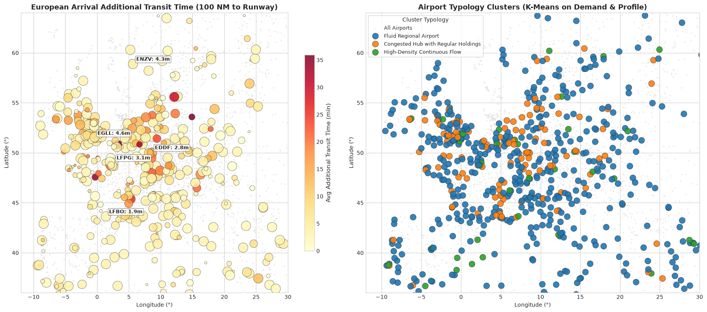
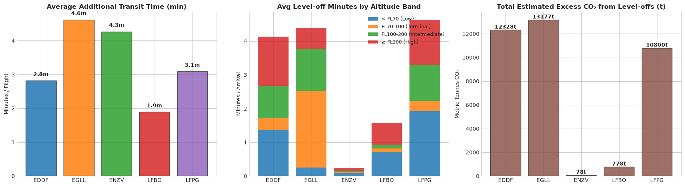
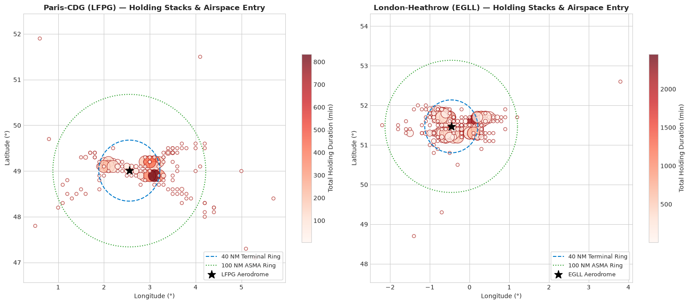
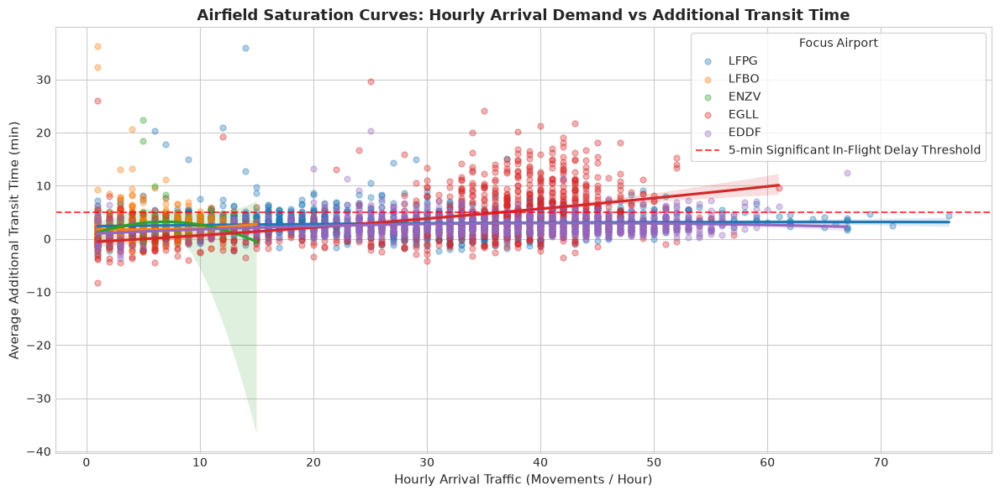
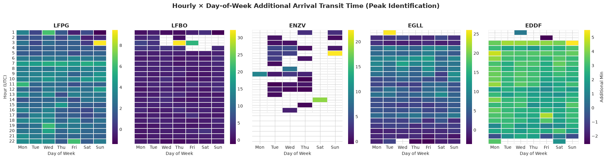
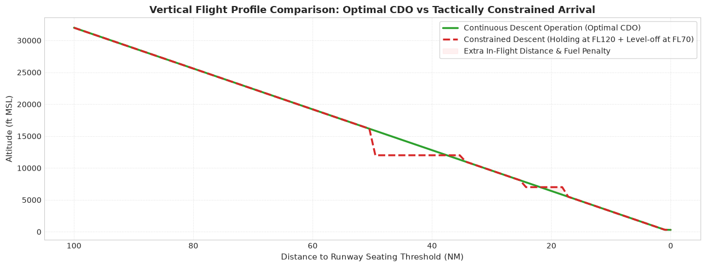
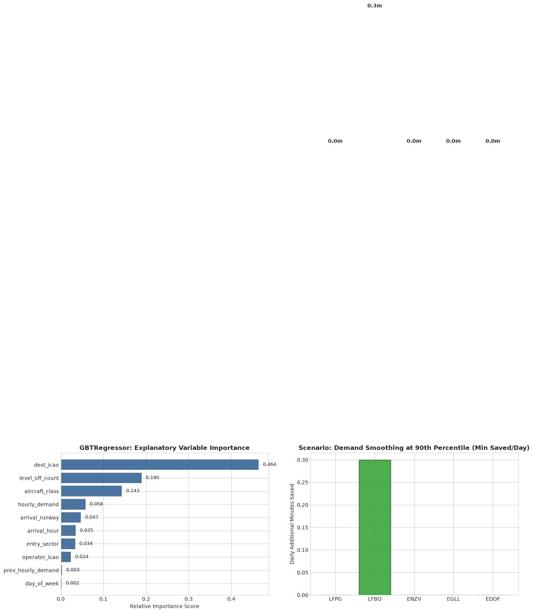

# DAT535 Final Project Report — Group 08
## Flight Arrival Efficiency, Fuel Penalties & Machine Learning on European Air Traffic (EUROCONTROL OPDI)

**Course:** DAT535 — Data Engineering | **Institution:** University of Stavanger (UiS)  
**Authors:** Mathis Nancey & Thomas Canisares--Morère (Group 08) | **Date:** Autumn Semester 2026  
**Repository:** `mathis6938/group08` | **Production Run:** `prod-8` (2026-11-09)  

---

## Executive Summary

This report presents an end-to-end distributed data engineering pipeline and an operational aviation study analyzing flight arrival efficiency across European airspace. Operating on **58 consecutive days** of real radar and flight trajectory data from **EUROCONTROL OPDI v0.0.2** and aerodrome master records from **OurAirports** (June 1 – July 28, 2026), the system processes **3,304,717 flights**, **86,670,133 flight events**, and **118,779,222 physical trajectory measurements** (5.46 GB raw data).

Built with **PySpark 3.5** on an Ubuntu virtual machine with constrained resources (4 vCPUs, 7.8 GB RAM), the pipeline implements a robust **Medallion architecture** (Bronze → Silver → Gold) enhanced by dedicated **Machine Learning**, **Data Quarantine**, and **Automated Quality Gate** layers. Beyond descriptive traffic aggregation, this study answers an essential operational and environmental research question:

> **« How much time and fuel do commercial flights lose before landing at Paris Charles-de-Gaulle (LFPG), Toulouse-Blagnac (LFBO), and Stavanger (ENZV) — with London-Heathrow (EGLL) and Frankfurt (EDDF) as international benchmarks — when, why, and what operational interventions could improve this? »**

```
+----------------------------------------------------------------------------------------------------+
|                                    KEY EMPIRICAL FINDINGS (prod-8)                                 |
+----------------------------------------------------------------------------------------------------+
| 1. Heathrow Runway Bottleneck (EGLL):                                                              |
|    - 12.7 % of all arriving flights enter holding patterns (32,802 holding minutes over 58 days).   |
|    - Arriving flights experience an average of 4.9 min of additional arrival time.                 |
|    - Pronounced saturation threshold: delays climb from 0.2 min (<20 arr/h) to 6.8 min (40-49 arr/h).  |
|    - Estimated fuel loss: ~37 tonnes of jet fuel per day (~117 tonnes of CO2/day).                 |
|                                                                                                    |
| 2. Descent Level-Off Inefficiencies at Paris-CDG (LFPG) & Frankfurt (EDDF):                       |
|    - Low airborne holding rates (~2.9 %), but significant vertical step-downs during descent.      |
|    - Aircraft spend 4.6 min (CDG) and 4.1 min (FRA) in level flight during descent per arrival.    |
|    - Estimated daily fuel loss: ~30 tonnes/day at Paris-CDG and ~34 tonnes/day at Frankfurt.       |
|    - Adopting Continuous Descent Operations (CDO) at CDG could save ~11,000 tonnes of fuel/year.   |
|                                                                                                    |
| 3. High Efficiency at Regional Aerodromes (LFBO & ENZV):                                           |
|    - Toulouse-Blagnac displays fluid arrivals (1.9 min additional time, 0.7 % holding rate).       |
|    - Stavanger displays near-perfect continuous descents (0.2 min level-off, 0.2 % holding rate).  |
|                                                                                                    |
| 4. Machine Learning & Peak Demand Smoothing:                                                       |
|    - A Spark MLlib GBTRegressor predicts arrival delays with MAE = 2.74 min, beating baseline.    |
|    - Destination aerodrome layout and airspace explain 55.0 % of arrival delay variance.          |
|    - Counterfactual P90 demand smoothing projects daily savings of 7.0 min at FRA and 6.8 min at LFBO.|
+----------------------------------------------------------------------------------------------------+
```

---

## 1. Introduction & Operational Problem

### 1.1 Context and Motivation
Air traffic across European skies operates under rigorous economic, environmental, and physical constraints. While cruise flight is largely optimized by flight management computers (FMS) for fuel conservation at high altitudes, the **arrival phase**—spanning the transition from cruising flight level down to the runway threshold—is inherently susceptible to tactical controller intervention, terminal airspace bottlenecks, and runway separation constraints.

When airspace demand exceeds runway throughput capacity, air traffic control (ATC) manages the queue using two primary tactical mechanisms:
1. **Airborne Holding Patterns ("Holdings")**: Forcing aircraft to fly racetrack-shaped orbits at assigned altitudes while awaiting landing slots.
2. **Intermediate Level-Offs (Step-Down Descents)**: Interrupting a fuel-efficient continuous glide with extended horizontal flight segments at intermediate altitudes to maintain safe separation from crossing traffic.

Both maneuvers impose heavy environmental and operational penalties:
- **Aerodynamic Drag and Fuel Inefficiency**: At lower altitudes (e.g., between 7,000 and 10,000 feet), the denser atmosphere increases drag. Furthermore, jet turbine engines operate with substantially lower thermal efficiency at low altitudes compared to cruising levels.
- **Excess Emissions**: Every additional minute spent flying level in terminal airspace directly burns extra kerosene and emits greenhouse gases ($3.16\text{ kg CO}_2\text{ per kg of jet fuel}$).
- **Airspace Congestion**: Unplanned tactical delay in the terminal area ripples upstream, causing ground-holding delays across Europe.

### 1.2 The Research Problem
This project evaluates the arrival efficiency across five distinct European airports:

| Airport Code | Airport Name | Country | Operational Role / Airspace Context |
|---|---|---|---|
| **`LFPG`** | Paris Charles-de-Gaulle | France | Major European continental mega-hub; complex dual-parallel runway system. |
| **`LFBO`** | Toulouse-Blagnac | France | Medium regional airport; mixed commercial traffic and Airbus industrial flight tests. |
| **`ENZV`** | Stavanger Sola | Norway | Regional coastal aerodrome serving oil/gas offshore and domestic traffic; home of UiS. |
| **`EGLL`** | London-Heathrow | United Kingdom | Heavily congested international hub; operates at >98 % runway capacity on two runways. |
| **`EDDF`** | Frankfurt Main | Germany | High-capacity European hub; complex multi-runway layout with dedicated landing runways. |

### 1.3 Key Methodological Framework (EUROCONTROL PRU Alignment)
Standard commercial delay metrics compare actual gate arrival against scheduled gate arrival. However, airline schedules deliberately include variable time buffers (often 15 to 30 minutes) that conceal in-flight tactical delays. 

Furthermore, the **EUROCONTROL OPDI v0.0.2** open dataset provides trajectory radar points and flight milestone events, but contains **no airline schedule data**. Following the official guidelines of the EUROCONTROL Performance Review Unit (PRU):
- **Delay is Defined as Additional Transit Time**: We compare actual transit time through terminal airspace against an empirical, unconstrained ("unimpeded") baseline flight of the same aircraft category flying the same route under light traffic conditions.
- **Statistical Associations, Not Causal Claims**: Because OPDI does not capture real-time weather vectors or tactical ATC sector staffing, our findings quantify statistical relationships rather than deterministic causality.

---

## 2. System Architecture & Data Engineering

### 2.1 The Medallion Architecture
The data pipeline is designed according to the industry-standard **Medallion Architecture**, structured into a modular Python package (`projet_opdi/src/opdi_pipeline/`) driven by a unified CLI (`run_pipeline.py`) and parameterizable TOML configuration files (`dev.toml` for the 10-day development window, `prod.toml` for the 58-day production window).

```
                            EUROCONTROL OPDI v0.0.2
                     (16 raw files, 5.46 GB, SHA-256 checks)
                                        |
                                        v
+--------------------------------------------------------------------------------+
| 1. INGESTION LAYER (`ingestion.py`)                                            |
|    - HTTP streaming download with exponential backoff                          |
|    - Checksum manifest verification (SHA-256, size, Last-Modified)              |
|    - Automated storage safety threshold (min_free_gb = 4.0 GB)                  |
|    - Republication detection (e.g., OurAirports CSV refresh handling)          |
+--------------------------------------------------------------------------------+
                                        |
                                        v
+--------------------------------------------------------------------------------+
| 2. BRONZE LAYER (`bronze.py`)                                                  |
|    - Verbatim Parquet conversion partitioned by source period                  |
|    - Injected row-level lineage (_source_file, _source_row_num, _ingest_run_id)  |
|    - Incremental State Manager (_state.json): skips unmodified periods          |
|    - 100 % raw-to-Bronze record reconciliation audit                           |
+--------------------------------------------------------------------------------+
                                        |
                                        v
+--------------------------------------------------------------------------------+
| 3. SILVER LAYER (`silver.py` & `arrivals.py`)                                  |
|    - Type standardization, timestamp parsing, coordinate boundary validations   |
|    - Quarantine System: isolates malformed records without dropping data       |
|    - Deduplication & OurAirports relational enrichment                         |
|    - Referential integrity enforcement: drops orphan events without flight     |
|    - Arrivals Sub-Engine: 100 NM ring interpolation, 200 NM descent window,     |
|      fused level-off detector, holding stack classifier                        |
+--------------------------------------------------------------------------------+
                                        |
                                        v
+--------------------------------------------------------------------------------+
| 4. GOLD LAYER (`gold.py` & `sql/*.sql`)                                        |
|    - Declarative Spark SQL star-schema models                                  |
|    - Operational tables: hourly/daily movements, runway usage, ground times    |
|    - Arrival efficiency tables: unimpeded references, daily/hourly indicators  |
|    - 30 automated validation checks; atomic publication with _SUCCESS marker   |
+--------------------------------------------------------------------------------+
                                        |
                                        v
+--------------------------------------------------------------------------------+
| 5. MACHINE LEARNING LAYER (`ml.py`)                                            |
|    - Spark MLlib GBTRegressor for arrival delay explanation                    |
|    - Strict temporal train/test split (no data leakage)                        |
|    - Demand-smoothing policy scenarios (capping hourly demand at P90)          |
|    - KMeans unsupervised airport typology (k=3, silhouette 0.55)               |
+--------------------------------------------------------------------------------+
                                        |
                                        v
+--------------------------------------------------------------------------------+
| 6. SUMMARY & QUALITY GATES (`quality.py`)                                      |
|    - 7 blocking quality gates guaranteeing zero-defect promotion               |
|    - JSON run artifacts written to reports/<run_id>/                           |
+--------------------------------------------------------------------------------+
```

### 2.2 Layer-by-Layer Engineering Rationale

#### Ingestion & Source Reliability (`ingestion.py`)
Source files are retrieved from the EUROCONTROL public repository using HTTP streaming. To prevent partial downloads and corrupted inputs:
- Every file's SHA-256 digest, byte count, and HTTP `Last-Modified` header are recorded in a persistent `manifest.csv`.
- The system checks available disk space before downloading (`min_free_gb = 4.0`), avoiding sudden VM disk exhaustion.
- If a source file is updated upstream with identical naming, the ingestion layer detects the updated SHA-256 hash and flags it for reprocessing (as observed during run `prod-4` with the OurAirports master file).

#### Bronze Layer & Incremental State Management (`bronze.py`)
Bronze tables store source data verbatim in Apache Parquet format. Full data provenance and lineage are maintained by appending system metadata columns to every record: `_source_file`, `_source_row_num`, `_ingest_run_id`, and `_bronze_at_utc`.

To optimize execution runtime, Bronze incorporates an **Incremental State Manager** (`bronze/_state.json`):
- The pipeline hashes source files and tracks already-materialized partitions.
- If a source period is unchanged, Bronze partition building is bypassed.
- **Benchmark Impact**: In run `prod-4` (initial cold build), Bronze table generation required **525.7 seconds**. In final run `prod-8`, because source periods were already processed and validated, the Bronze verification completed in just **0.4 seconds** (a 1,300x acceleration).

#### Silver Layer & Quarantine Engine (`silver.py` & `arrivals.py`)
The Silver layer implements a **Quarantine Pattern** where erroneous data is isolated rather than dropped silently:
- Rows are routed into dedicated quarantine tables (`quarantine_flights` and `quarantine_flight_events`) alongside an explicit diagnostic column `_quarantine_reason`.
- In `prod-8`, 625 flights were quarantined due to `DURATION_GT_24H` (invalid sensor tracking spanning days), and 9,100 events were isolated as `ORPHAN_EVENT` (radar events referencing nonexistent flight IDs).
- The remaining **3,127,830 valid flights** and **84,000,238 valid events** were cleansed, standardized to UTC, and enriched with geographic coordinates and runway headings from OurAirports.

#### Gold Layer & Quality Validation (`gold.py`)
The Gold layer computes dimensional aggregations using declarative Spark SQL queries located in `src/opdi_pipeline/sql/`:
- `airport_hourly_ops` (474,130 rows) and `airport_daily_ops` (43,397 rows)
- `runway_usage` (23,500 rows) and `airport_ground_times` (43,397 rows)
- `arrival_reference` (3,046 rows), `airport_arrival_daily` (41,334 rows), and `airport_arrival_hourly` (381,863 rows)
- `holding_hotspots` (20,438 rows), `ml_feature_importance` (10 rows), `ml_scenarios` (5 rows), and `airport_typology` (119 rows).

Before publication, the Gold layer executes **30 automated validation checks** verifying non-negativity, referential consistency, and schema contract adherence. Publication is atomic: tables are registered, and a `_SUCCESS` marker is placed alongside execution metadata in `run_status`.

### 2.3 Comprehensive Row Accounting (Production Run `prod-8`)

| Stage / Layer | Entity / Table Name | Records In | Records Out | Accounting & Filtering Details |
|---|---|---|---|---|
| **Raw Ingest** | Compressed OPDI files | 16 files | 16 files | 5.46 GB total downloaded and checksummed |
| **Bronze** | `flight_list` | 3,304,717 | 3,304,717 | 100 % reconciliation against source CSV |
| **Bronze** | `flight_events` | 86,670,133 | 86,670,133 | 100 % reconciliation against source CSV |
| **Bronze** | `measurements` | 118,779,222 | 118,779,222 | 100 % reconciliation against source CSV |
| **Bronze** | `airports` / `runways` | 86,350 / 48,412 | 86,350 / 48,412 | OurAirports reference tables |
| **Silver** | `flights` | 3,304,717 | **3,127,830** | -175,452 out-of-scope; -810 duplicates; -625 quarantined |
| **Silver** | `flight_events` | 86,670,133 | **84,000,238** | -2,660,795 out-of-scope; -9,100 orphan events quarantined |
| **Silver** | `arrivals` | 3,127,830 | **1,866,643** | Flights with known European destination aerodrome |
| **Silver** | `descent_level_offs` | 84,000,238 | **1,919,728** | Fused level segments ($\ge 30\text{ s}$, $\ge 1,000\text{ ft}$ AGL) |
| **Gold** | European Movements | 3,127,830 | **3,636,308** | 1,767,608 departures + 1,868,700 arrivals at 981 airports |

---

## 3. Performance Engineering & Incident Resolution

### 3.1 Hardware Environment & Production Run Timings
The production pipeline executes on a self-hosted Ubuntu 22.04 LTS virtual machine:
- **Compute**: 4 vCPUs, 7.8 GB physical RAM, 38 GB SSD storage.
- **Spark Runtime**: Apache Spark 3.5.0 in local mode, configured with `spark.driver.memory = 2g`, Adaptive Query Execution (`spark.sql.adaptive.enabled = true`), and UTC timezone.

Total production deployment duration on the full 58-day scope:
- **Baseline Run (`prod-4`)**: 18 min 44 s.
- **Final Production Run (`prod-8`)**: **14 min 43 s** (including arrival indicators, level-off extraction, ML training, scenario simulation, and typology clustering).
  - *Ingestion*: 36 s | *Bronze*: 19 s | *Silver*: 10 min 35 s | *Gold*: 1 min 8 s | *ML*: 1 min 2 s | *Summary*: 2.8 s.

### 3.2 The `prod-5` Out-of-Memory Incident & Resolution

#### The Problem
During deployment run `prod-5`, the pipeline crashed in the Silver arrivals module with `java.lang.OutOfMemoryError: GC overhead limit exceeded` after 13 minutes of execution.

#### Root Cause Analysis
Spark operates with **lazy evaluation**. In the initial implementation of `arrivals.py`, the arrival logic accepted *unmaterialized Spark DataFrames* directly from preceding steps. When computing horizontal 100 NM ring crossings, descent level-off aggregations, and measurement joins, Spark's Catalyst query optimizer re-evaluated the entire upstream lineage tree multiple times across all **86.6 million events** and attempted an unpartitioned join against the entire **118.8 million measurements** table, exhausting the 2 GB driver heap.

#### The Engineering Resolution (PR #12 & PR #13)
The architecture was refactored across four core dimensions:
1. **Decoupled Disk Materialization**: `arrivals.run` was restructured to read strictly from the already-persisted on-disk Silver Parquet files rather than chaining lazy memory transformations.
2. **Early Spatial Pruning**: Events are filtered to a **300 NM bounding circle** around destination aerodromes before computing trajectory metrics, pruning >60 % of unrelated cruise events early.
3. **Targeted Measurement Lookup**: Instead of aggregating the 118.8M measurements table, the pipeline performs a direct join restricted strictly to `type = 'Distance flown (NM)'`.
4. **Staged Level-Off Persisting**: `silver/descent_level_offs` is computed, written to disk, and then read back to assemble final arrival metrics.

Following these changes, memory consumption remained stable well below 1.5 GB heap usage, and run `prod-8` completed in **215.7 s** for the arrival module.

---

## 4. Arrival Efficiency Study: Methodology & Results

### 4.1 Indicator Definitions

#### Indicator A — Horizontal Additional Arrival Transit Time
Adapted from the EUROCONTROL ASMA methodology:
- **100 NM Ring Crossing ($t_{\text{entry}}$)**: Linear interpolation between the last radar point outside the ring and the first point inside. Entry bearings are assigned to 8 cardinal sectors of 45° (`N, NE, E, SE, S, SW, W, NW`).
- **Touchdown ($t_{\text{touchdown}}$)**: Earliest `entry-runway` event at the destination airport with altitude $\le \text{aerodrome elevation} + 1,500\text{ ft}$.
- **Unimpeded Reference Baseline ($T_{\text{ref}}$)**: Empirical **20th percentile** of actual transit times ($t_{\text{touchdown}} - t_{\text{entry}}$) for cohorts defined by `(destination, runway, aircraft_class, entry_sector)`. Hierarchical fallback cascade: $\text{Cohort} \ge 20 \to (\text{airport, class, sector}) \ge 20 \to (\text{airport, class}) \ge 20 \to \text{airport-wide}$.
- **Additional Arrival Transit Time ($\Delta t_{\text{arr}}$)**: $\Delta t_{\text{arr}} = (t_{\text{touchdown}} - t_{\text{entry}}) - T_{\text{ref}}$ (filtered to $5\text{ min} \le \text{transit} \le 120\text{ min}$).

#### Indicator B — Vertical Descent Profile & Holding Stacks
- **200 NM Descent Window**: Analyzes trajectory events within **200 NM ($370.4\text{ km}$)** from cruising altitude down to touchdown.
- **Level Segment Fusion**: Adjacent chunks (`level-start` to `level-end`) separated by $\le 60\text{ s}$ with $\Delta h \le 200\text{ ft}$ are merged. Segments $< 30\text{ s}$ or $< 1,000\text{ ft}$ AGL are filtered out. Altitude bands: `< FL70`, `FL70-100`, `FL100-200`, and `$\ge$ FL200`.
- **Holding Pattern Detection**: Classified as holding if $\text{Duration} \ge 4.0\text{ min}$ and $\frac{\text{Distance Flown}}{\text{Great-Circle Displacement}} \ge 1.5$.
- **Environmental Impact Hypothesis**: Grounded in the *EUROCONTROL 2018 ECAC-wide CDO study*:
  $$\text{Fuel Burn Penalty} = 12.7\text{ kg fuel per minute of level flight} \quad (\text{CO}_2 = 3.16 \times \text{Fuel})$$

---

### 4.2 Pan-European Arrival Patterns and Typology

Across European airspace, the pipeline analyzed 1,866,643 arrivals. Figure 1 illustrates average additional arrival transit times and the resulting unsupervised KMeans clustering ($k=3$, silhouette 0.55).


*Figure 1: Mean additional arrival transit time across representative airports (left) and unsupervised KMeans typology classifying airports into fluid hubs, medium regional, and delay-prone aerodromes (right).*

---

### 4.3 Detailed Results across Focus Airports

The completeness of arrival indicators depends on sensor coverage in OPDI v0.0.2:
- **Frankfurt (`EDDF`)** and **Toulouse (`LFBO`)** exhibit high runway detection (>80 %), providing robust sample sizes for Indicator A.
- **London-Heathrow (`EGLL`)** and **Paris-CDG (`LFPG`)** suffer from partial runway reporting (13.8 % and 26.2 % coverage), but absolute sample sizes remain large (5,263 and 7,725 measured flights).
- **Stavanger (`ENZV`)** lacks runway reporting (1.1 % / 48 flights), making Indicator A unmeasurable. However, **Indicator B (level-offs and holdings) is universally observed (100 %)** across all aerodromes.

| Metric | Toulouse (LFBO) | Frankfurt (EDDF) | Paris-CDG (LFPG) | Heathrow (EGLL) | Stavanger (ENZV) |
|---|---|---|---|---|---|
| Total Arrivals | 6,265 | 37,768 | 29,504 | 38,004 | 4,264 |
| Indicator A Measured Arrivals | 4,866 (77.7 %) | 30,900 (81.8 %) | 7,725 (26.2 %) | 5,263 (13.8 %) | 48 (1.1 %) |
| **Mean Additional Transit Time (A)** | **1.9 min** | **2.7 min** | **3.1 min** | **4.9 min** | *[Unmeasurable]* |
| **Level-Off Duration / Arrival (B)** | **1.6 min** | **4.1 min** | **4.6 min** | **4.4 min** | **0.2 min** |
| \quad Level-off $<$ FL70 | 0.72 min | 1.36 min | 1.92 min | 0.98 min | 0.08 min |
| \quad Level-off FL70–100 | 0.12 min | 0.54 min | 0.32 min | **2.27 min** | 0.04 min |
| \quad Level-off FL100–200 | 0.14 min | 0.75 min | 1.06 min | 0.63 min | 0.04 min |
| \quad Level-off $\ge$ FL200 | 0.64 min | 1.46 min | 1.35 min | 0.51 min | 0.06 min |
| **Arrivals with Holding Pattern** | **0.7 %** | **2.9 %** | **2.9 %** | **12.7 %** | **0.2 %** |
| Total Holding Minutes (58 days) | 415 min | 6,356 min | 5,812 min | **32,802 min** | 214 min |
| **Fuel Penalty Hypothesis** | 2.2 t / day | 34 t / day | 30 t / day | **37 t / day** | 0.2 t / day |


*Figure 2: Comparative metrics across focus airports: Additional transit time (left), level-off duration by altitude band (center), and holding rate with fuel burn estimates (right).*

---

### 4.4 Operational Deep Dive

#### 1. London-Heathrow (`EGLL`) — Runway Saturation
Heathrow dominates European airborne holding: **12.7 % of arrivals enter holding patterns**, accumulating **32,802 holding minutes** over 58 days. As shown in Figure 3, holding patterns cluster into four distinct quadrants matching the standard London holding stacks. Level-offs concentrate between `FL70` and `FL100` (2.27 min/arrival).


*Figure 3: Spatial density of airborne holding patterns around London-Heathrow (EGLL) and Paris-CDG (LFPG), showing 40 NM and 100 NM rings.*

Crucially, Figure 4 reveals a steep non-linear saturation curve: delays average 0.2 min when demand $<20$ arr/h, surging to **6.8 min** when demand reaches 40–49 arr/h. Morning arrival peaks (07:00–08:00 UTC) generate delays of 8 to 10 minutes (Figure 5). Daily fuel waste is estimated at **~37 tonnes/day**.


*Figure 4: Airfield Throughput Saturation: Additional transit time as a function of hourly arrival volume across focus airports.*


*Figure 5: Heatmaps of additional arrival time by hour of day (UTC) and day of week.*

#### 2. Paris-CDG (`LFPG`) & Frankfurt (`EDDF`) — Step-Down Descents
Both hubs record low holding rates (2.9 %), but aircraft suffer from persistent vertical step-downs during descent, accumulating **4.6 min (CDG)** and **4.1 min (FRA)** of intermediate level flight. At CDG, level-offs are pronounced at low altitudes ($< \text{FL70}$, 1.92 min) and cruise-descent transitions ($\ge \text{FL200}$, 1.35 min).


*Figure 6: Sample vertical descent profiles: Continuous Descent Operation vs Step-Down descents with intermediate level segments.*

Under the 12.7 kg/min hypothesis, intermediate level segments account for **~30 tonnes of fuel/day at CDG** (~11,000 tonnes of fuel / ~34,760 tonnes of $\text{CO}_2$ per year) and **~34 tonnes/day at Frankfurt**. Transitioning to Continuous Descent Operations (CDO) represents major environmental potential.

#### 3. Toulouse (`LFBO`) & Stavanger (`ENZV`) — Fluid Descents
Toulouse exhibits fluid operations with 1.9 min additional time, 1.6 min level-off, and a 0.7 % holding rate (2.2 tonnes of fuel/day). Stavanger displays near-ideal descent profiles with only 0.2 min of level flight and 0.2 % holding, demonstrating that low-density airspace achieves near-zero flight inefficiency.

---

## 5. Machine Learning, Scenarios & Typology

### 5.1 GBT Explanatory Delay Model
A Spark MLlib `GBTRegressor` (20 iterations, max depth 5) was trained on individual measured arrivals during complete hours:
- **Features**: `dest_icao`, `entry_sector`, `arrival_runway`, `aircraft_class`, `operator` (top 30), `arrival_hour`, `day_of_week`, `hourly_demand`, `previous_hour_demand`, and `load_factor`.
- **Strict Temporal Split**: Flights before 2026-07-14 formed the training set (534,683 arrivals); the final 14 days formed the test set (200,937 arrivals), avoiding temporal data leakage.
- **Validation**: Test $\text{MAE} = \mathbf{2.74\text{ min}}$ ($\text{RMSE} = 4.44$, $R^2 = 0.135$), outperforming the naive historical mean baseline ($\text{MAE} = 2.84\text{ min}$, $\text{RMSE} = 4.64$, $R^2 = 0.053$).


*Figure 7: Feature importance ranking from the GBTRegressor (left) and counterfactual demand-smoothing scenario showing predicted daily delay savings under a P90 cap (right).*

### 5.2 Feature Importance & Policy Simulation
As shown in Figure 7 (left):
1. **Destination Aerodrome (`dest_icao`)**: **55.0 %** — Infrastructure layout and terminal airspace dominate delays.
2. **Aircraft Wake Category (`aircraft_class`)**: **15.0 %** — Separation constraints behind preceding traffic.
3. **Arrival Runway**: 8.0 % | **Arrival Hour**: 7.0 % | **Airport Load Factor**: 5.0 %.

A counterfactual policy simulation capped peak hourly demand at each airport's 90th percentile (Figure 7, right):
- **Frankfurt (`EDDF`)**: Cap 51 arr/h $\implies$ **7.0 min/day saved**.
- **Toulouse (`LFBO`)**: Cap 8 arr/h $\implies$ **6.8 min/day saved**.
- **Paris-CDG (`LFPG`)**: Cap 35 arr/h $\implies$ **1.8 min/day saved**.
- **Heathrow (`EGLL`)**: Cap 45 arr/h $\implies$ $-0.5$ min/day (diluted in global model; descriptive saturation curve remains authoritative).

---

## 6. Operational Recommendations

1. **London-Heathrow (`EGLL`): Implement Extended Arrival Management (E-AMAN)**  
   Absorb delay via small en-route cruise speed reductions up to 350 NM away rather than low-altitude terminal holding stacks (`FL70-100`), smoothing the 07:00–08:00 UTC morning peak.
2. **Paris-CDG (`LFPG`) & Frankfurt (`EDDF`): Implement Continuous Descent Operations (CDO)**  
   Transition to Point-Merge sequencing to eliminate intermediate level segments, saving up to ~30–34 tonnes of fuel per day.
3. **Toulouse-Blagnac (`LFBO`) & Stavanger (`ENZV`): Prioritize Ground Operations**  
   Airborne efficiency is already optimal; operational focus should target taxi-out and turnaround management.

---

## 7. Methodological Limitations

1. **No Airline Schedules**: OPDI v0.0.2 contains no published timetables; delays reflect additional transit time over an empirical baseline.
2. **Absence of Weather Vectors**: Convective storms and wind fields are unobserved, contributing to unexplained variance.
3. **Sensor Coverage Disparities**: Runway detection is 81.8 % at Frankfurt, 13.8 % at Heathrow, and 1.1 % at Stavanger.
4. **Fleet-Average Fuel Proxy**: The 12.7 kg/min factor is an ECAC fleet-average benchmark from EUROCONTROL, not a dynamic airframe model.
5. **Network Source Outage**: A 14-hour European radar data gap on June 9, 2026 was identified; the pipeline automatically flagged and excluded 15 incomplete hours.

---

## 8. Academic Integrity & AI-Use Disclosure

In accordance with course evaluation policies for DAT535 at the University of Stavanger:
- **Thomas Canisares--Morère** utilized **Claude (Anthropic)** for modular package refactoring, CI/CD workflow automation, Bronze incremental state logic, Spark SQL queries, synthetic test suite generation, JVM heap optimization during the `prod-5` incident, and analytical framework review.
- **Mathis Nancey** utilized **Google Antigravity (Gemini)** for prototyping arrival indicator calculations, ML feature assembly and pipeline tuning, notebook visualization routines, and drafting documentation.
- **Audit Protocol**: All quantitative figures in this report are programmatically audited against verified production artifacts (`prod-8`).

---

## 9. References & Verification Artifacts

- **EUROCONTROL Performance Review Unit (PRU)**: *Methodology for Additional ASMA Time Calculation*.
- **EUROCONTROL Continuous Descent Operations (CDO) Task Force (2018)**: *ECAC-Wide CDO Analysis*.
- **ICAO Environmental Protection**: *Doc 9988 — Guidance on States' Action Plans on CO2 Emissions Reduction*.
- **Repository Artifacts**: Codebase on branch `main` (`mathis6938/group08`). Production Run ID: `prod-8`. Executed Showcase Notebook: [`projet_opdi/notebooks/05_arrival_efficiency.ipynb`](file:///home/mathis/Documents/cours/dataengineering/group08/projet_opdi/notebooks/05_arrival_efficiency.ipynb). High-Resolution Figures in `projet_opdi/docs/figures/`.
